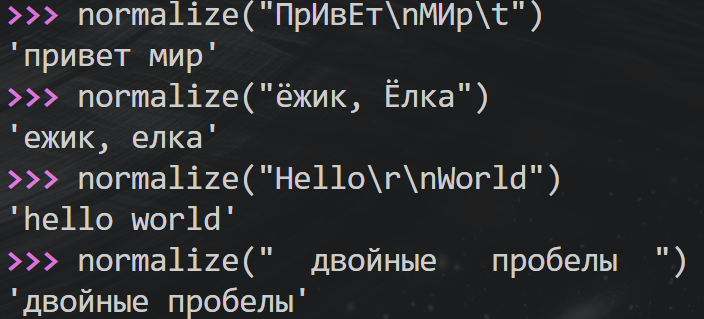
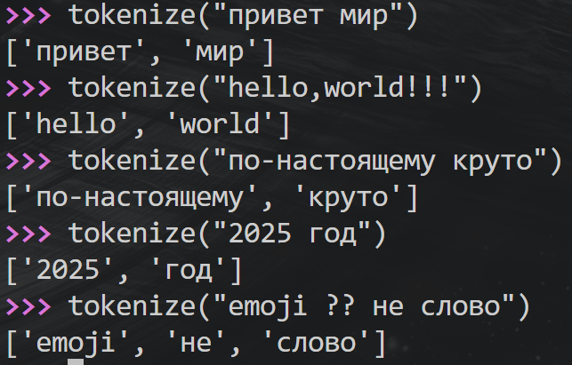
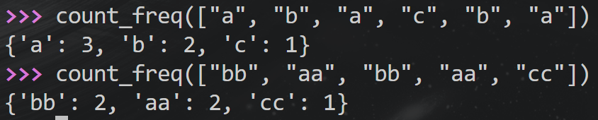
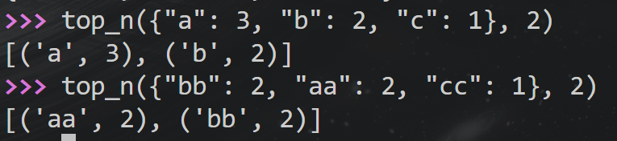
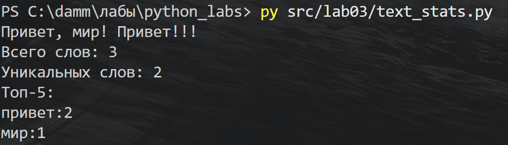
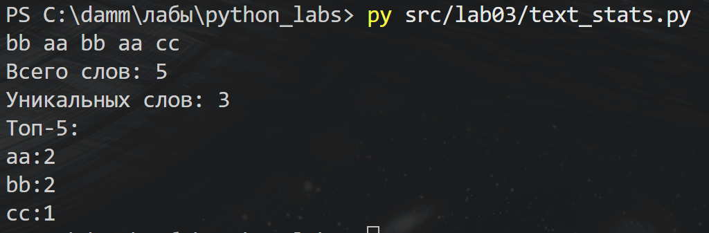

# ЛР3 — Тексты и частоты слов

## Задание А — src/lib/text.py

### normalize

Сначала я привожу текст к нижнему регистру. По умолчанию использую casefold(), а если casefold выключен — lower(). Если включён yo2e, заменяю «ё» на «е». В конце разбиваю строку через split() и собираю обратно через один пробел. Так убираются лишние пробелы, табуляции и переносы строк.

```python
def normalize(text: str, *, casefold: bool = True, yo2e: bool = True) -> str:
    """Приводит текст к нижнему регистру и убирает лишние пробелы."""
    if casefold:
        text = text.casefold()
    else:
        text = text.lower()

    if yo2e:
        text = text.replace("ё", "е")

    return " ".join(text.split())
```



### tokenize

Здесь я использовал re.findall(), чтобы получить из строки список слов. Цифры тоже считаются словами, а дефис внутри слова сохраняется. Например, «по-настоящему» остаётся одним элементом списка.

```python
import re


def tokenize(text: str) -> list[str]:
    """Выделяет слова, сохраняя дефисы внутри слов."""
    return re.findall(r"\w+(?:-\w+)*", text)
```



### count_freq

Я прохожу по списку слов и считаю, сколько раз встретилось каждое. Если слова ещё нет в словаре, записываю 1. Если оно уже есть, прибавляю 1 к его частоте.

```python
def count_freq(tokens: list[str]) -> dict[str, int]:
    """Подсчитывает количество появлений каждого слова."""
    freq = {}

    for word in tokens:
        if word in freq:
            freq[word] += 1
        else:
            freq[word] = 1

    return freq
```



### top_n

Сначала я сортирую пары «слово — частота». В ключе сортировки беру частоту со знаком минус, чтобы частые слова оказались в начале. Если частоты совпадают, сравниваются сами слова. После сортировки оставляю первые n пар.

```python
def sort_key(pair: tuple[str, int]) -> tuple[int, str]:
    """Задаёт сортировку по убыванию частоты, затем по алфавиту."""
    word, count = pair
    return -count, word


def top_n(freq: dict[str, int], n: int = 5) -> list[tuple[str, int]]:
    """Возвращает топ-N слов. Отрицательное N — ValueError."""
    if n < 0:
        raise ValueError("N не должно быть отрицательным")

    pairs = freq.items()
    result = sorted(pairs, key=sort_key)
    return result[:n]
```



## Задание Б — src/lab03/text_stats.py

Здесь я использовал функции из задания А. Программа читает одну строку после нажатия Enter, выделяет слова и считает их частоты. По длине списка получаю общее количество слов, по длине словаря — количество уникальных. Потом вывожу до пяти самых частых слов.

```python
import sys
import os

sys.path.append(os.path.abspath(os.path.join(os.path.dirname(__file__), "..")))

from lib.text import normalize, tokenize, count_freq, top_n


def text_stats(text: str) -> None:
    """Выводит количество слов, уникальных слов и топ-5."""
    norm_text = normalize(text)
    tokens = tokenize(norm_text)
    freq = count_freq(tokens)
    top = top_n(freq)

    print("Всего слов:", len(tokens))
    print("Уникальных слов:", len(freq))
    print("Топ-5:")

    for word, count in top:
        print(f"{word}:{count}")


if __name__ == "__main__":
    text = input()
    text_stats(text)
```

Запуск из папки python_labs:

```powershell
py src/lab03/text_stats.py
```

Для проверки я ввёл две строки в отдельных запусках: «Привет, мир! Привет!!!» и «bb aa bb aa cc». Во втором примере видно, что при равной частоте aa выводится раньше bb.


