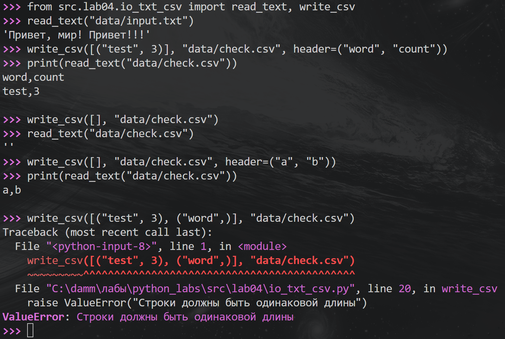
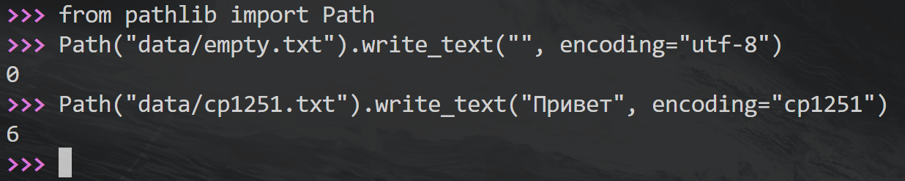
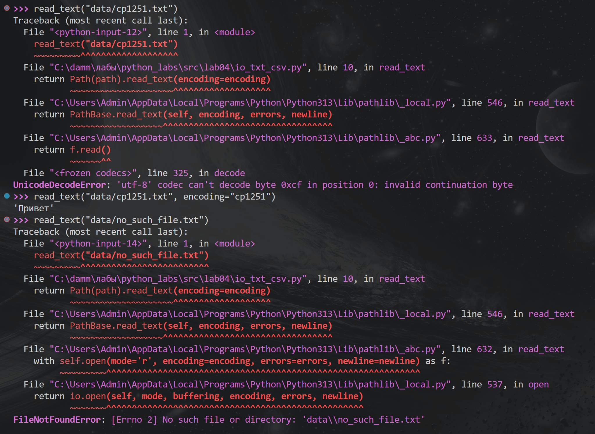
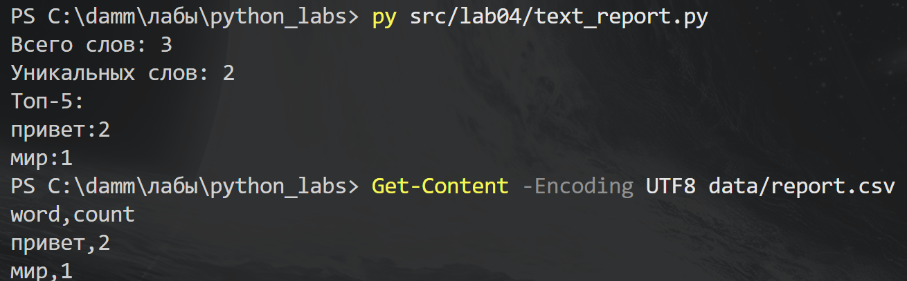
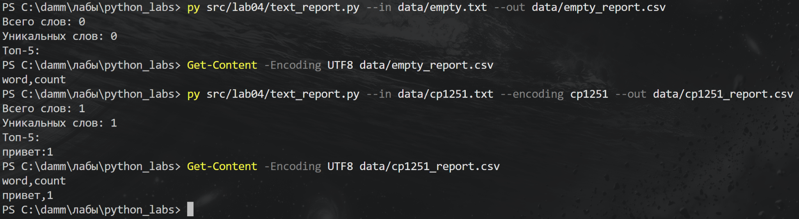

# ЛР4 — Файлы TXT и CSV

## Задание А — Чтение и запись файлов

В файле `io_txt_csv.py` я написал функции `read_text` и `write_csv`.

### Чтение текста и запись CSV

Функция `read_text` читает файл целиком и возвращает его содержимое строкой. По умолчанию используется кодировка UTF-8.

Функция `write_csv` записывает данные в CSV. Значения разделяются запятыми. Если передан заголовок, он записывается первой строкой. Существующий файл перезаписывается.

Я проверил чтение текста, запись строки с заголовком и запись пустого списка. Без заголовка получается пустой файл, с заголовком — файл только с одной строкой.

При передаче строк разной длины возникает `ValueError`.



### Подготовка файлов для проверки

Для следующих проверок я создал пустой файл `empty.txt` и файл `cp1251.txt` со словом «Привет» в кодировке Windows-1251.

Числа 0 и 6 в выводе — количество записанных символов.



### Проверка ошибок

При попытке прочитать файл Windows-1251 как UTF-8 возникает `UnicodeDecodeError`. Если указать `encoding="cp1251"`, текст читается правильно.

При чтении несуществующего файла возникает `FileNotFoundError`.



---

## Задание Б — Отчёт по тексту

В файле `text_report.py` я использовал функции из ЛР3: `normalize`, `tokenize`, `count_freq` и `top_n`.

Программа читает текст из файла, приводит его к нижнему регистру, выделяет слова и подсчитывает их частоты.

В CSV записываются все слова по убыванию частоты. При одинаковой частоте слова располагаются по алфавиту. В терминале выводятся общее количество слов, количество уникальных слов и топ-5.

### Обычный запуск

Все команды выполняются из корня репозитория — папки `python_labs`.

В файле `data/input.txt` находится текст:

```text
Привет, мир! Привет!!!
```

Команда запуска:

```powershell
py src/lab04/text_report.py
```

По умолчанию программа читает `data/input.txt` и записывает результат в `data/report.csv`.

Посмотреть полученный CSV можно командой:

```powershell
Get-Content -Encoding UTF8 data/report.csv
```

В результате получилось 3 слова и 2 уникальных. Слово «привет» встретилось два раза, «мир» — один.



### Пустой файл и другая кодировка

Проверка пустого файла:

```powershell
py src/lab04/text_report.py --in data/empty.txt --out data/empty_report.csv
Get-Content -Encoding UTF8 data/empty_report.csv
```

Для пустого файла оба счётчика равны нулю. В CSV остаётся только заголовок `word,count`.

Проверка файла в Windows-1251:

```powershell
py src/lab04/text_report.py --in data/cp1251.txt --encoding cp1251 --out data/cp1251_report.csv
Get-Content -Encoding UTF8 data/cp1251_report.csv
```

В файле находится слово «Привет». После обработки в отчёт записывается `привет,1`. Выходной CSV всегда сохраняется в UTF-8.



### Особенности работы

Параметры `--in` и `--out` позволяют указать входной и выходной файлы. Параметр `--encoding` задаёт кодировку входного текста.

Папка для выходного файла должна существовать. Если входного файла нет или выбрана неверная кодировка, программа завершается с соответствующей ошибкой.

Текст читается целиком. Для больших файлов лучше использовать построчное чтение, чтобы занимать меньше памяти.