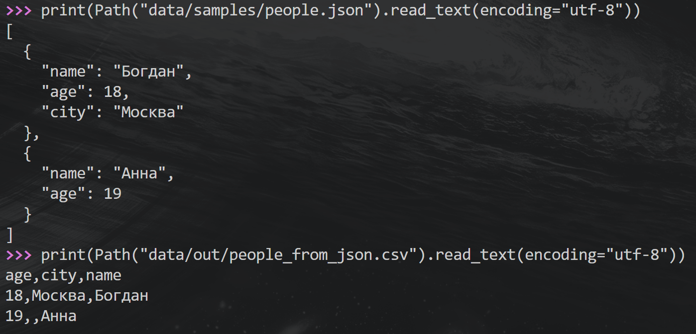
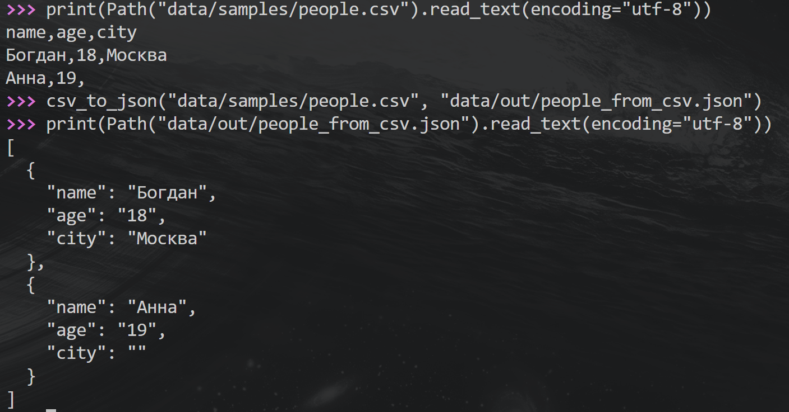
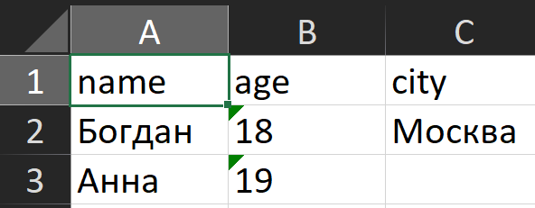

# ЛР5 — JSON и конвертации

В этой работе я сделал преобразование JSON в CSV, CSV в JSON и CSV в Excel.

## Подготовка

Для работы с Excel используется библиотека openpyxl. Она указана в requirements.txt.

Установка:

```powershell
py -m pip install -r requirements.txt
```

Команды выполняются из папки python_labs. Исходные файлы находятся в data/samples, а результаты сохраняются в data/out. Эти папки нужно создать заранее.

Для вызова функций я запустил Python:

```powershell
py
```

Затем подключил нужные функции и Path для просмотра файлов:

```python
from pathlib import Path
from src.lab05.json_csv import json_to_csv, csv_to_json
from src.lab05.csv_xlsx import csv_to_xlsx
```

## Задание А — JSON и CSV

### JSON → CSV

В функции json_to_csv я сначала читаю JSON и проверяю, что внутри находится непустой список словарей.

Названия столбцов собираются из всех словарей и сортируются по алфавиту. Если какого-то поля у человека нет, в CSV на его месте остаётся пустая ячейка.

Для проверки я использовал people.json с двумя людьми. У Анны специально не указан город.

Запуск:

```python
json_to_csv("data/samples/people.json", "data/out/people_from_json.csv")
```

Просмотр исходного файла и результата:

```python
print(Path("data/samples/people.json").read_text(encoding="utf-8"))
print(Path("data/out/people_from_json.csv").read_text(encoding="utf-8"))
```

Я сравнил записи в обоих файлах. Два человека сохранились, столбцы расположились в порядке age, city, name. Поле города у Анны осталось пустым.



### CSV → JSON

Функция csv_to_json читает CSV и создаёт отдельный словарь для каждой строки с данными. Ключи берутся из заголовка таблицы.

Все значения остаются строками. Поэтому возраст в полученном JSON записан в кавычках. Для записи я использовал отступы и сохранение русских букв без замены на escape-последовательности.

Запуск:

```python
csv_to_json("data/samples/people.csv", "data/out/people_from_csv.json")
```

Просмотр файлов:

```python
print(Path("data/samples/people.csv").read_text(encoding="utf-8"))
print(Path("data/out/people_from_csv.json").read_text(encoding="utf-8"))
```

В результате получилось два объекта с ключами name, age и city. Имена и возраст сохранились, а пустое поле города стало пустой строкой.



## Задание Б — CSV в Excel

В функции csv_to_xlsx я использовал openpyxl. Программа создаёт книгу, называет лист Sheet1 и переносит в него строки CSV вместе с заголовком.

Ширина каждого столбца подбирается по самому длинному значению с запасом в два символа. При этом она не может быть меньше 8.

Запуск:

```python
csv_to_xlsx("data/samples/people.csv", "data/out/people.xlsx")
```

Полученный people.xlsx я открыл в Excel. В таблице сохранились заголовки и обе записи. Текст помещается в столбцах.

Возраст записан как текст, поэтому Excel может показывать зелёные отметки рядом с числами.



## Проверка ошибок

Для проверки пустых файлов можно создать empty.json и empty.csv:

```python
Path("data/samples/empty.json").write_text("", encoding="utf-8")
Path("data/samples/empty.csv").write_text("", encoding="utf-8")
```

Следующие команды выполняются по одной, поскольку каждая должна вызвать ошибку.

Пустой JSON:

```python
json_to_csv("data/samples/empty.json", "data/out/check.csv")
```

Ожидается JSONDecodeError. Эта ошибка является разновидностью ValueError.

Пустой CSV:

```python
csv_to_json("data/samples/empty.csv", "data/out/check.json")
```

Ожидается ValueError.

Пустой CSV при создании Excel:

```python
csv_to_xlsx("data/samples/empty.csv", "data/out/check.xlsx")
```

Ожидается ValueError.

Отсутствующий файл:

```python
csv_to_json("data/samples/no_such_file.csv", "data/out/check.json")
```

Если такого файла нет, возникает FileNotFoundError.

## Особенности работы

Все текстовые файлы читаются и записываются в UTF-8. Разделитель CSV — запятая.

Первая строка CSV считается заголовком. Названия столбцов не должны быть пустыми или повторяться. Количество полей в каждой строке должно совпадать с количеством заголовков. Для чтения и проверки CSV используется общая функция read_csv_rows.

Программа не может сама определить, является ли первая обычная строка заголовком или данными. Поэтому исходный CSV нужно подготовить с заголовком.

Для JSON поддерживается непустой список словарей без вложенных списков и словарей. Отсутствующие поля и значения null при записи в CSV становятся пустыми ячейками.

При обратном преобразовании из CSV все значения становятся строками. Исходные типы чисел не восстанавливаются.

CSV, в котором есть только заголовок, преобразуется в пустой JSON-список или Excel только с заголовком.

Неподходящее расширение файла, неверная структура данных и строки CSV разной длины вызывают ValueError. Если входного файла нет, возникает FileNotFoundError.

Готовые файлы сохраняются в data/out. При повторном запуске файл с тем же названием перезаписывается.