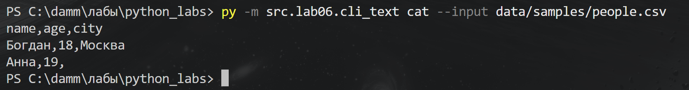
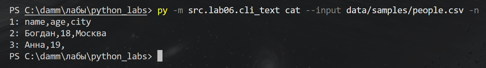
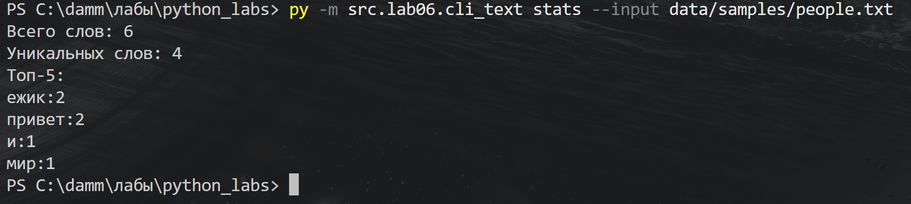
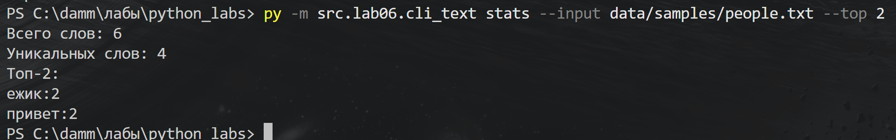
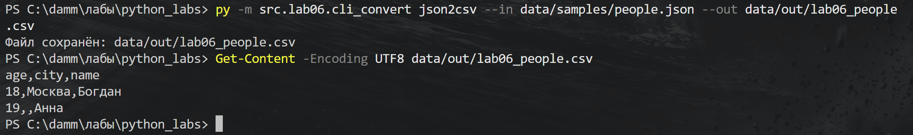
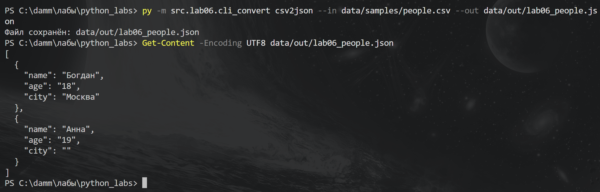
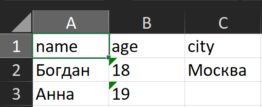
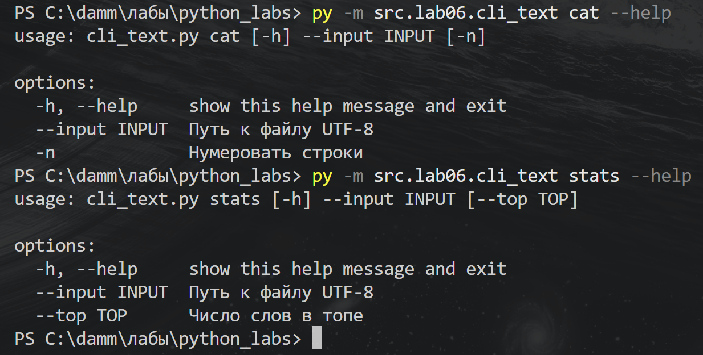
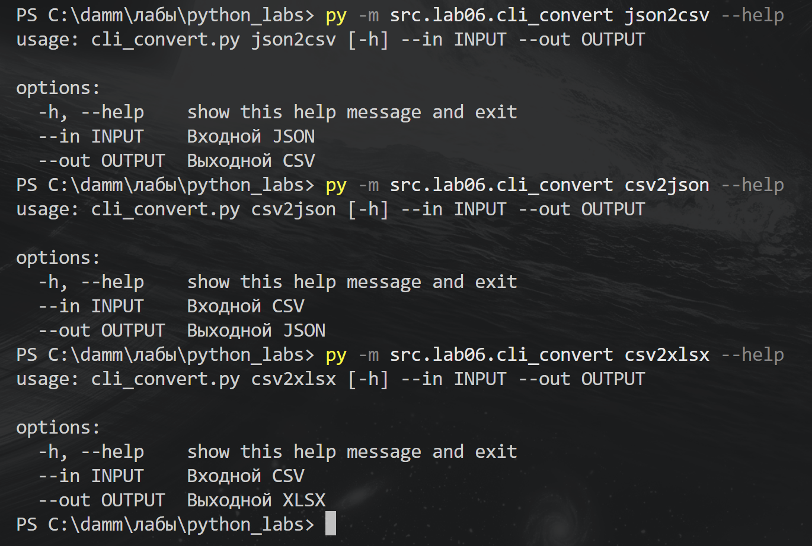
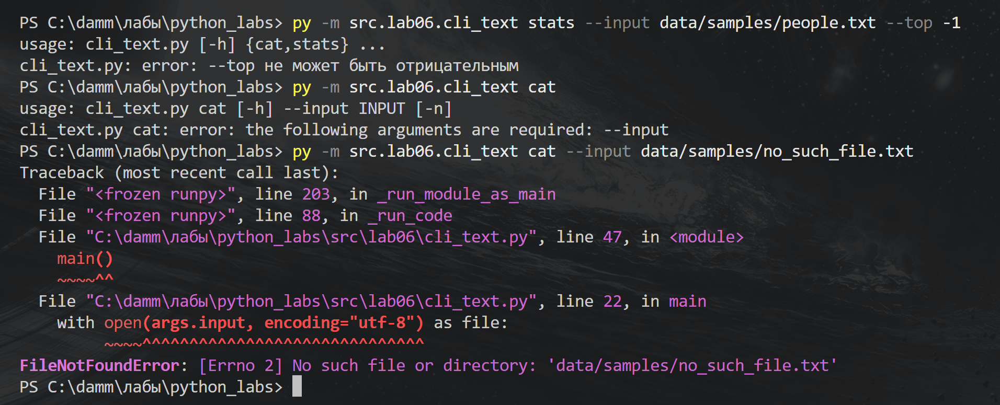

# ЛР6 — Работа с argparse

В этой лабе я сделал запуск программ через командную строку. Для текста использовал функции из ЛР3, для конвертации файлов — из ЛР5. Через argparse добавил выбор команды и параметры запуска.

Все команды ниже выполняются из папки python_labs.

## Задание А — cli_text.py

### Вывод содержимого файла

Команда cat выводит текст из файла. Путь к нему указывается после --input.

```powershell
py -m src.lab06.cli_text cat --input data/samples/people.csv
```



Если добавить -n, рядом с каждой строкой появится её номер.

```powershell
py -m src.lab06.cli_text cat --input data/samples/people.csv -n
```



### Подсчёт слов

Команда stats считает слова в тексте и показывает самые частые. Для проверки я создал файл data/samples/people.txt:

```text
Привет, мир! Привет!!!
Ёжик и ёжик.
```

Запустил программу:

```powershell
py -m src.lab06.cli_text stats --input data/samples/people.txt
```

Получилось 6 слов, из них 4 уникальных. Буква ё заменяется на е, а все слова приводятся к нижнему регистру. При одинаковой частоте слова выводятся по алфавиту.



По умолчанию выводится топ-5. Через --top можно указать другое количество:

```powershell
py -m src.lab06.cli_text stats --input data/samples/people.txt --top 2
```

Теперь в топе только два слова — ежик и привет.



## Задание Б — cli_convert.py

Здесь я добавил три команды для конвертации файлов. После --in указывается исходный файл, после --out — куда записать результат.

Для проверки взял файлы people.json и people.csv из ЛР5.

### JSON в CSV

```powershell
py -m src.lab06.cli_convert json2csv --in data/samples/people.json --out data/out/lab06_people.csv
Get-Content -Encoding UTF8 data/out/lab06_people.csv
```

Первой командой я создал CSV, второй посмотрел его содержимое. Столбцы идут по алфавиту. У Анны не указан город, поэтому это поле осталось пустым.



### CSV в JSON

```powershell
py -m src.lab06.cli_convert csv2json --in data/samples/people.csv --out data/out/lab06_people.json
Get-Content -Encoding UTF8 data/out/lab06_people.json
```

Из CSV получился список из двух словарей. Значения читаются как строки, поэтому возраст в JSON записан в кавычках.



### CSV в Excel

```powershell
py -m src.lab06.cli_convert csv2xlsx --in data/samples/people.csv --out data/out/lab06_people.xlsx
```

После запуска открыл файл в Excel и проверил таблицу. В ней заголовки и две записи — Богдан и Анна. Конвертер создаёт лист Sheet1 и подбирает ширину столбцов по содержимому, но не меньше 8.



Для Excel используется openpyxl из ЛР5. Если библиотека ещё не установлена:

```powershell
py -m pip install -r requirements.txt
```

## Справка

У каждой команды есть --help. Он показывает, какие параметры можно передать. Саму справку формирует argparse, в коде я указал названия параметров и их описания.

```powershell
py -m src.lab06.cli_text cat --help
py -m src.lab06.cli_text stats --help
```



```powershell
py -m src.lab06.cli_convert json2csv --help
py -m src.lab06.cli_convert csv2json --help
py -m src.lab06.cli_convert csv2xlsx --help
```



## Проверка ошибок

Проверил три случая.

Сначала передал отрицательное количество слов:

```powershell
py -m src.lab06.cli_text stats --input data/samples/people.txt --top -1
```

Программа сообщила, что --top не может быть отрицательным.

Потом не указал путь к файлу:

```powershell
py -m src.lab06.cli_text cat
```

Появилось сообщение, что требуется --input.

И попробовал открыть файл, которого нет:

```powershell
py -m src.lab06.cli_text cat --input data/samples/no_such_file.txt
```

Получил FileNotFoundError.



## Что нужно учитывать

Файлы с текстом читаются в UTF-8. Для пустого текста stats выводит нулевые счётчики, а при --top 0 не выводит сами слова.

Результаты конвертации сохраняются в data/out/. Эта папка должна существовать. Если файл с таким именем уже есть, он перезаписывается.

Проверки JSON и CSV остались в функциях из ЛР5. Если они вызывают ValueError, cli_convert выводит сообщение через parser.error.